# Checkd (checkD) — Native Android Hackathon Event Attendance System

[](https://kotlinlang.org)
[-3DDC84?logo=android&logoColor=white)](https://developer.android.com)
[](https://developer.android.com/jetpack/compose)
[](https://supabase.com)
[](https://developer.android.com/training/camerax)
[](https://developers.google.com/ml-kit)
[](https://dagger.dev/hilt/)
[](https://gradle.org)

**Checkd** is a modern, offline-first, high-throughput Android event management and attendance tracking platform built specifically for large-scale hackathons, technical symposia, and collegiate conferences. 

Engineered with **Jetpack Compose**, **Google ML Kit**, **CameraX**, and **Supabase PostgreSQL / Realtime CDC**, Checkd replaces paper rosters, fragile spreadsheets, and slow web forms with rapid QR badge scanning, live attendee synchronization, and dedicated role-based portals for **Volunteers**, **SPOCs (Single Points of Contact)**, and **Event Organizers / Admins**.

---

## Table of Contents

1. [Built for Purpose (Why Checkd?)](#built-for-purpose-why-checkd)
2. [Key Capabilities & Features](#key-capabilities--features)
3. [Technology Stack](#technology-stack)
4. [System Architecture](#system-architecture)
5. [Application Components](#application-components)
   - [Presentation Layer (Jetpack Compose)](#1-presentation-layer-jetpack-compose)
   - [Domain Layer (Clean Architecture)](#2-domain-layer-clean-architecture)
   - [Data Layer (Remote, Local & Synchronization)](#3-data-layer-remote-local--synchronization)
   - [Hardware & Feedback Utilities](#4-hardware--feedback-utilities)
6. [Offline-First Resilience & Realtime Synchronization](#offline-first-resilience--realtime-synchronization)
7. [Role-Based Access Control (RBAC)](#role-based-access-control-rbac)
8. [Sample QR Test Tokens](#sample-qr-test-tokens)
9. [Setup, Build & Execution](#setup-build--execution)
10. [Testing & Verification](#testing--verification)

---

## Built for Purpose (Why Checkd?)

Major hackathons (36 to 48 hours, 500–2,000+ participants) encounter critical logistical challenges at physical checkpoints:

| Problem in Typical Hackathons | Checkd Solution |
|---|---|
| **Queue Congestion at Meals & Workshops** | Continuous 60 FPS CameraX + ML Kit scanning marks participants in under **100 milliseconds** per scan without button pressing. |
| **Duplicate Meal / Swag Claims** | Real-time atomic database conflict detection immediately flags duplicate attempts with clear visual, acoustic, and haptic warnings. |
| **Unreliable Venue Wi-Fi & Auditorium Dead Zones** | Full offline-first cache of all participants, teams, and SPOC data. Instant offline validation with queued background sync that drains when network connectivity resumes. |
| **Team Tracking Across Multiple Milestones** | Track/College SPOCs monitor their assigned teams' progress across all hackathon milestone events in real time and can call missing members directly via single-tap phone dialers. |
| **Glare & Extreme Venue Lighting** | High-contrast monochrome design system ensuring maximum screen legibility whether scanning under blinding spotlights or in dark nighttime hacking auditoriums. |

---

## Key Capabilities & Features

- **Blazing-Fast Continuous Scanner**: Full-screen CameraX viewfinder with animated reticle overlays, torch toggle, camera-flip support, and automatic scan debouncing (1.5s per duplicate code).
- **Single & Bulk Scan Modes**: Scan single participants with instant slide-up feedback, or toggle **Bulk Scan Mode** to rapidly queue entire teams or busloads before submitting an atomic batch.
- **Standalone QR Verifier**: Dedicated badge inspector that decodes participant QR badges offline, displaying identity dossiers: Name, USN/ID, Assigned Team, Leader Status, and Assigned SPOC phone numbers.
- **SPOC Dashboard**: Scoped view for track mentors to observe team attendance percentages across all started events, see exactly who has not checked in, and initiate phone calls with one tap.
- **Admin Command Center**: Real-time attendance matrix, live overview analytics, event creation and time-window scheduling, team and SPOC directory inspection, and participant journey timelines.
- **Supabase Realtime CDC**: Subscribes to PostgreSQL database write streams via WebSockets; attendee counters update instantly across all volunteer devices without pull-to-refresh.
- **Haptic & Audio Confirmation**: Multi-sensory feedback (low-latency audio beeps via `SoundPool` and specific vibrational haptic pulses) so volunteers can scan without looking at the screen.

---

## Technology Stack

### Core Platform & Tooling
| Component | Technology | Version | Purpose |
|---|---|---|---|
| **Language** | Kotlin | 2.1.0 | Modern Android development with Coroutines & StateFlow |
| **Target Runtime** | Android 15 (VanillaIceCream) | API 35 (`minSdk 26`, `compileSdk 35`) | Cutting-edge Android platform support with backward compatibility to Android 8.0 |
| **Build System** | Gradle + AGP | Gradle 9.1.0 / AGP 9.0.1 | Fast incremental compilation with Gradle Version Catalogs (`libs.versions.toml`) |
| **Code Generation** | Google KSP | 2.1.0-1.0.29 | Annotation processing for Hilt and Room/Serialization |

### Architecture & UI Framework
| Component | Technology | Version | Purpose |
|---|---|---|---|
| **UI Toolkit** | Jetpack Compose | BOM 2024.12.01 | Declarative reactive UI |
| **Design System** | Material 3 (Monochrome) | 1.3.1 | High-contrast black, white, and neutral palette with colored status chips |
| **Architecture** | Clean Architecture (MVVM / MVI) | — | Unidirectional data flow with separated Presentation, Domain, and Data layers |
| **Navigation** | Navigation Compose | 2.8.5 | Single-activity typed navigation graph with animated transitions and route guards |
| **Dependency Injection** | Dagger Hilt | 2.60.1 | Compile-time dependency injection across ViewModels, Repositories, and DataSources |
| **Concurrency** | Kotlin Coroutines & Flow | 1.9.0 | Asynchronous stream processing and reactive state holding |

### Camera & Computer Vision
| Component | Technology | Version | Purpose |
|---|---|---|---|
| **Camera Viewfinder** | AndroidX CameraX | 1.4.1 | Hardware camera management, lifecycle binding, preview stream, and torch control |
| **Barcode Recognition** | Google ML Kit Barcode Scanning | 17.3.0 | On-device, bundled machine learning model for instantaneous offline QR code decoding |

### Cloud Backend & Networking
| Component | Technology | Version | Purpose |
|---|---|---|---|
| **Backend as a Service** | Supabase Cloud | Multiplatform 3.1.1 | Cloud PostgreSQL database, PostgREST API, Auth, and Realtime CDC |
| **HTTP Engine** | Ktor Client | 3.0.3 | High-performance networking engine (`cio`, `android`, `websockets`) |
| **Realtime Streams** | Supabase Realtime | 3.1.1 | WebSocket-based Postgres Change Data Capture (CDC) subscriptions |
| **Serialization** | Kotlinx Serialization | 1.7.3 | Reflection-free, compile-time JSON encoding and decoding |

### Persistence & Device Hardware
| Component | Technology | Version | Purpose |
|---|---|---|---|
| **User Preferences** | AndroidX DataStore | 1.1.1 | Reactive, thread-safe persistence for staff session tokens and theme preferences |
| **Local Cache** | File Storage / JSON Serializer | — | Offline participant, team, and attendance snapshot caches |
| **Audio Feedback** | Android `SoundPool` | Platform | Low-latency audio cues for success, duplicate, and error states |
| **Haptic Feedback** | Android `Vibrator` / `VibrationEffect` | Platform | Tactile sensory pulses for instant physical confirmation |
| **Network Observer** | Android `ConnectivityManager` | Platform | Reactive network state listener for auto-reconnection and sync triggers |

---

## System Architecture

Checkd follows strict **Clean Architecture** and **SOLID** principles:

```mermaid
flowchart TD
    subgraph UI ["Presentation Layer (Jetpack Compose)"]
        HomeScreen["HomeScreen / EventCard"]
        EventDetailScreen["EventDetailScreen"]
        ScannerScreen["ScannerScreen / CameraX Viewfinder"]
        VerifierScreen["QrVerifierScreen"]
        SpocDashboard["SpocDashboardScreen"]
        AdminDashboard["AdminDashboardScreen"]
        SettingsScreen["SettingsScreen"]
    end

    subgraph ViewModels ["State & ViewModels"]
        HomeVM["HomeViewModel"]
        DetailVM["EventDetailViewModel"]
        ScannerVM["ScannerViewModel"]
        VerifierVM["QrVerifierViewModel"]
        SpocVM["SpocDashboardViewModel"]
        AdminVM["AdminViewModel"]
        SettingsVM["SettingsViewModel"]
    end

    subgraph Domain ["Domain Layer (Business Logic)"]
        UC_MarkAttendance["MarkAttendanceUseCase"]
        UC_Verify["VerifyParticipantUseCase"]
        UC_Stats["GetEventsWithStatsUseCase"]
        UC_Spoc["GetSpocDashboardUseCase"]
        UC_Admin["GetAdminDirectoryUseCase"]
        ProgCalc["ProgressCalculator (IST Time & Ratios)"]
    end

    subgraph Data ["Data Layer (Repositories & Sync)"]
        Repo_Attendance["AttendanceRepositoryImpl"]
        Repo_Matrix["AttendanceMatrixRepositoryImpl"]
        Repo_Cache["ParticipantCacheRepositoryImpl"]
        Repo_Auth["AuthRepositoryImpl"]
        SyncMgr["SyncManager & NetworkObserver"]
    end

    subgraph Backend ["Cloud Infrastructure (Supabase)"]
        Supa_Realtime["Supabase Realtime (CDC WebSockets)"]
        Supa_PostgREST["Supabase Cloud API (PostgREST)"]
        Supa_DB[(PostgreSQL Cloud Database)]
    end

    UI --> ViewModels
    ViewModels --> Domain
    Domain --> Data
    Data --> Backend
```



---

## Application Components

### 1. Presentation Layer (Jetpack Compose)

The UI is built entirely with Jetpack Compose using a strict monochrome design system where color is reserved exclusively for status states (Green for live/present, Yellow for duplicates, Red for errors).

#### Screens & Flows
- **`HomeScreen`** ([`presentation/home`](app/src/main/java/com/example/eventattendance/presentation/home/HomeScreen.kt)):
  - Lists all active and scheduled hackathon events with animated progress bars (`Scanned / Total`).
  - Displays dynamic status chips: `Upcoming`, `Live`, and `Ended` computed against Indian Standard Time (IST).
  - Quick action toolbar to jump into the QR Verifier or open Application Settings.
- **`EventDetailScreen`** ([`presentation/eventdetails`](app/src/main/java/com/example/eventattendance/presentation/eventdetails/EventDetailScreen.kt)):
  - Real-time attendee roster with immediate full-text search filtering by name, USN, or team.
  - Action header featuring prominent **Scan QR Code** and **Bulk Scan** buttons.
  - Supports SPOC scoping: filters displayed participants strictly to the logged-in SPOC's assigned teams.
- **`ScannerScreen`** ([`presentation/scanner`](app/src/main/java/com/example/eventattendance/presentation/scanner/ScannerScreen.kt)):
  - 60 FPS CameraX viewfinder with custom corner bracket canvas overlays and a sweep-line scan animation.
  - Hardware controls: Flashlight/Torch toggle and Front/Rear camera switcher.
  - Slide-up bottom sheets with contextual status feedback banners:
    - `Success` (Green): Participant checked in with timestamp.
    - `Already Checked In` (Yellow): Duplicate scan alert with previous check-in time.
    - `Invalid QR` (Red): Code not recognized in the event registration database.
    - `Event Closed` (Gray): Attempted check-in outside the authorized time window.
- **`QrVerifierScreen`** ([`presentation/verifier`](app/src/main/java/com/example/eventattendance/presentation/verifier/QrVerifierScreen.kt)):
  - Offline badge verification terminal.
  - Immediately inspects scanned participant tokens against the local cache, displaying team name, leader status, and assigned SPOC with an integrated direct phone dialer button.
- **`SpocDashboardScreen`** ([`presentation/spoc`](app/src/main/java/com/example/eventattendance/presentation/spoc/SpocDashboardScreen.kt)):
  - Dedicated portal for Single Points of Contact (track/college leads).
  - Three distinct tabs:
    1. **Events Tab**: Attendance cards showing team-specific progress ratios across each milestone event.
    2. **Team Progress Tab**: Detailed team breakdown showing members present vs. pending with direct call shortcuts.
    3. **Profile Tab**: SPOC details and session logout controls.
- **`AdminDashboardScreen`** ([`presentation/admin`](app/src/main/java/com/example/eventattendance/presentation/admin/AdminDashboardScreen.kt)):
  - Organizer central station with 5 management tabs:
    1. **Overview Tab**: Live attendance matrix, total check-in count, and overall hackathon completion rate.
    2. **Events Tab**: Create, edit, and adjust event time windows on the fly using `EventFormDialog`.
    3. **Directory Tab**: Hierarchical directory of SPOCs, teams, and participants.
    4. **SPOCs Tab**: SPOC performance leaderboard and progress tracking.
    5. **Settings Tab**: Administrative diagnostics and database cache management.
- **`ParticipantDetailScreen`** ([`presentation/admin/ParticipantDetailScreen.kt`](app/src/main/java/com/example/eventattendance/presentation/admin/ParticipantDetailScreen.kt)):
  - Visual participant journey timeline documenting every event checkpoint the attendee attended or missed.
- **`StaffAuthScreen`** ([`presentation/authentication`](app/src/main/java/com/example/eventattendance/presentation/authentication/StaffAuthScreen.kt)):
  - Secure credential gate for SPOC and Admin accounts with persistent session state stored in DataStore.

#### Reusable Design Components
- `CheckdTopAppBar`: Standardized monochrome header bar with navigation icons, action pills, and status badges.
- `OfflineStatusBanner`: Animated indicator notifying users when working in local offline mode.
- `EventStatusChip`: Pill badge rendering `LIVE`, `UPCOMING`, or `ENDED` status.
- `CallButton`: Single-tap phone dialer button invoking `Intent.ACTION_DIAL`.
- `ProgressBar`: Monochrome progress bar with percentage counter.
- `LastUpdatedText`: Relative timestamp display (e.g., "Updated 2m ago").

---

### 2. Domain Layer (Clean Architecture)

Encapsulates all business rules, algorithms, and use cases without dependency on UI or database frameworks:

#### Progress & Time Engine (`ProgressCalculator.kt`)
- **IST Time Normalization**: Enforces `Asia/Kolkata` timezone evaluation across all event timestamps (`starts_from`, `ends_on`).
- **Dynamic Event Status Calculation**:
  - `UPCOMING`: Current time is before `starts_from`.
  - `LIVE`: Current time is between `starts_from` and `ends_on`.
  - `ENDED`: Current time has passed `ends_on`.
- **Mathematical Progress Computation**:
  - `eventProgress(memberPIds, presentSet)`: Computes exact present count and percentage fraction.
  - `overallProgress(memberPIds, events)`: Computes aggregate attendance across all *started* events.
  - `pendingMembers(memberPIds, presentSet)`: Computes set delta (`memberPIds - presentSet`) to isolate missing attendees.

#### Core Use Cases
- `MarkAttendanceUseCase`: Validates participant eligibility and submits single or batch attendance records.
- `VerifyParticipantUseCase`: Resolves scanned QR tokens against cached registration data.
- `GetEventsWithStatsUseCase`: Combines raw event schedules with real-time attendance counts.
- `GetEventDetailUseCase`: Queries attendee lists with search filtering and sorting.
- `GetSpocDashboardUseCase`: Loads scoped teams and attendance statistics for a specific SPOC.
- `GetAdminDirectoryUseCase`: Aggregates the full relational tree of SPOCs, teams, and participants.
- `ManageEventsUseCase`: Orchestrates event creation and time-window scheduling.
- `StaffLoginUseCase` & `LogoutUseCase`: Manages role switching and DataStore credential persistence.
- `ClearLocalCacheUseCase`: Purges local cache files safely.

---

### 3. Data Layer (Remote, Local & Synchronization)

#### Repositories
- **`AttendanceRepositoryImpl`** ([`data/repository/AttendanceRepositoryImpl.kt`](app/src/main/java/com/example/eventattendance/data/repository/AttendanceRepositoryImpl.kt)):
  - Manages event attendance feeds and local cache files (`events_cache.json`).
  - Initiates and maintains Supabase Realtime CDC WebSocket subscriptions.
  - Dispatches attendance marking and validation requests to the Supabase backend.
- **`AttendanceMatrixRepositoryImpl`** ([`data/repository/AttendanceMatrixRepositoryImpl.kt`](app/src/main/java/com/example/eventattendance/data/repository/AttendanceMatrixRepositoryImpl.kt)):
  - Fetches and caches the complete multi-event attendance matrix.
  - Powers real-time analytics across SPOC and Admin dashboards.
- **`ParticipantCacheRepositoryImpl`** ([`data/repository/ParticipantCacheRepositoryImpl.kt`](app/src/main/java/com/example/eventattendance/data/repository/ParticipantCacheRepositoryImpl.kt)):
  - Maintains in-memory and disk-persisted mappings of all registered participants, teams, and SPOC contacts.
- **`AuthRepositoryImpl`** ([`data/repository/AuthRepositoryImpl.kt`](app/src/main/java/com/example/eventattendance/data/repository/AuthRepositoryImpl.kt)):
  - Coordinates anonymous volunteer sessions and staff authentication via Supabase GoTrue and DataStore preferences.
- **`UserPreferencesRepositoryImpl`** ([`data/repository/UserPreferencesRepositoryImpl.kt`](app/src/main/java/com/example/eventattendance/data/repository/UserPreferencesRepositoryImpl.kt)):
  - Persists sound feedback, haptic feedback, and theme modes (`LIGHT`, `DARK`, `SYSTEM`).

#### Data Sources & Remote Procedures
- **`RemoteDataSource`**: Direct client wrapper managing network calls to Supabase via PostgREST.
- **`AuthRemoteDataSource`**: Supabase authentication client managing session initialization and tokens.
- **`SyncManager`**: Monitors network connectivity and coordinates auto-resynchronization.

---

### 4. Hardware & Feedback Utilities

- **`BarcodeAnalyzer`**: Implements CameraX `ImageAnalysis.Analyzer`. Processes camera image proxies, extracts luminance buffers, and feeds them into ML Kit's `BarcodeScanner` pipeline.
- **`HapticFeedbackUtil`**: Executes distinct tactile feedback patterns using `Vibrator` and `VibrationEffect`:
  - *Success*: Short double-pulse.
  - *Warning / Duplicate*: Medium double-buzz.
  - *Error*: Long alert pulse.
- **`AudioFeedbackUtil`**: Manages low-latency audio feedback via Android `SoundPool` for instantaneous auditory confirmation in loud event environments.
- **`NetworkConnectivityObserver`**: Emits reactive connectivity status flows (`Available`, `Losing`, `Lost`, `Unavailable`) via Android `ConnectivityManager` callbacks.

---

## Offline-First Resilience & Realtime Synchronization

Checkd employs a robust multi-tiered synchronization architecture:

```
[Camera Scanner]
      │
      ▼
[In-Memory Participant Cache] ◄── Cached from Supabase upon app launch
      │
      ├─► (Online)  ──► Supabase PostgREST ──► Instant DB Commit
      │                                                │
      │                                     Supabase Realtime CDC
      │                                                │
      ▼                                                ▼
[Local Event Cache] ◄─────────────────────── All Volunteer Devices
(Instant UI Update)
```

1. **Pre-Cached Attendee Roster**: Upon app startup, Checkd downloads and caches the full participant and team catalog to local storage. This allows the scanner to validate participant names, teams, and USNs even if internet access is lost.
2. **Postgres Realtime CDC**: Checkd registers listeners on the `supabase_realtime` publication. When any volunteer checks in a participant, Supabase streams the update across WebSockets, updating all connected devices simultaneously.
3. **Network Auto-Healing**: The `NetworkConnectivityObserver` listens to Android system network states. When recovering from offline status, `SyncManager` automatically triggers a cloud resynchronization.

---

## Role-Based Access Control (RBAC)

Checkd provides three security tiers guarded by Navigation Compose route guards:

| Role | Access Level | Primary Screens | Description |
|---|---|---|---|
| **Volunteer** | Default / Public | `Home`, `EventDetail`, `Scanner`, `QrVerifier`, `Settings` | Scan QR codes, mark attendance, verify participant credentials, search rosters. No login required. |
| **SPOC** | Authenticated | `SpocDashboard` (Events, Team Progress, Profile), Scoped `EventDetail`, `ParticipantDetail` | Track assigned teams, observe milestone check-ins, identify absent members, initiate phone calls. |
| **Admin** | Authenticated | `AdminDashboard` (Overview, Events, Directory, SPOCs, Settings), `SpocDetail`, `ParticipantDetail` | Full system control: create/reschedule events, inspect full database directories, view complete event attendance matrix. |

Sessions are stored securely in Android **DataStore Preferences** and restored across app restarts. Logging out returns the app to Volunteer mode while maintaining active anonymous scan sessions.

---

## Sample QR Test Tokens

When generating test QR codes or testing with the camera scanner, the barcode string should match the participant's `p_id`:

| Participant Name | Participant ID (`p_id`) | Team | Expected Scan Behavior (Event 1) |
|---|---|---|---|
| **Aditya Sharma** | `P101` | TEAM_A | ⚠️ **Already Checked In** (Duplicate Warning) |
| **Saanvi Rao** | `P102` | TEAM_A | ⚠️ **Already Checked In** (Duplicate Warning) |
| **Mohan Kulkarni** | `P103` | TEAM_B | ⚠️ **Already Checked In** (Duplicate Warning) |
| **Ishita Verma** | `P104` | TEAM_B | ✅ **Success** (Green Check-in) |
| **Rohan Mehta** | `P105` | TEAM_C | ✅ **Success** (Green Check-in) |
| **Ananya Iyer** | `P106` | TEAM_C | ✅ **Success** (Green Check-in) |
| **Invalid Attendee** | `UNKNOWN_CODE_99` | N/A | ❌ **Invalid QR** (Red Error) |

---

## Setup, Build & Execution

### Prerequisites
- **Android Studio Ladybug (2024.2+)** or **Android Studio Meerkat / Iguana**
- **Java Development Kit (JDK)**: JDK 17 or JDK 21 (configured as Gradle JDK)
- **Android Device or Emulator**: Android 8.0 (API level 26) or higher with camera support

### 1. Clone the Repository
```bash
git clone https://github.com/geeked-aadi/Checkd.git
cd Checkd
```

### 2. Configure Supabase Credentials
Create a `local.properties` file in the project root (or verify existing entries):
```properties
SUPABASE_URL=https://your-project-id.supabase.co
SUPABASE_ANON_KEY=your-supabase-publishable-anon-key
```

### 3. Build and Run via Gradle
```bash
# Build Debug APK
./gradlew assembleDebug

# Install on connected device
./gradlew installDebug
```

The compiled APK will be located at:
```text
app/build/outputs/apk/debug/app-debug.apk
```

---

## Testing & Verification

Checkd includes a comprehensive unit testing suite covering domain business logic, progress algorithms, and cache verification:

```bash
# Run unit tests
./gradlew testDebugUnitTest
```

### Test Suite Highlights
- **`ProgressCalculatorTest`** ([`app/src/test/.../ProgressCalculatorTest.kt`](app/src/test/java/com/example/eventattendance/domain/calculator/ProgressCalculatorTest.kt)):
  - Validates IST timezone parsing and conversion.
  - Verifies event status transitions (`UPCOMING` -> `LIVE` -> `ENDED`).
  - Asserts exact progress ratio and percentage calculation logic.
- **`VerifierAndCacheTest`** ([`app/src/test/.../VerifierAndCacheTest.kt`](app/src/test/java/com/example/eventattendance/domain/usecase/VerifierAndCacheTest.kt)):
  - Tests offline QR validation against cached participant dossiers.
- **`SpocAnalyticsTest`** ([`app/src/test/.../SpocAnalyticsTest.kt`](app/src/test/java/com/example/eventattendance/presentation/admin/SpocAnalyticsTest.kt)):
  - Tests SPOC-level team progress aggregation and leaderboard ranking.
- **`ParticipantJourneyTest`** ([`app/src/test/.../ParticipantJourneyTest.kt`](app/src/test/java/com/example/eventattendance/presentation/admin/ParticipantJourneyTest.kt)):
  - Validates chronological event timeline generation for individual attendees.

---

## License

This project was built for hackathon event management.
